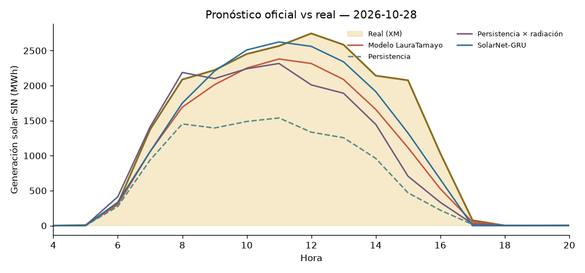

# ☀️ Liga de Pronóstico Solar Colombia — Leaderboard

_Actualizado: 2026-10-31 11:58 (hora Colombia) · Métrica: MAE en horas de sol (06–18 h) · Skill = 1 − MAE/MAE_persistencia (positivo = le ganas a la persistencia)_

## 🏆 Liga oficial (predicciones hechas ANTES de conocer el dato real)

| # | Modelo | Autor | Días | MAE (MWh) | nMAE | Skill vs persistencia |
|---|---|---|---|---|---|---|
| 🥇 | Modelo LauraTamayo | LauraTamayo12 | 10 | 203.5 | 14.5% | +31.0% |
| 🥈 | SolarNet-GRU | profe | 10 | 224.2 | 16.0% | +22.2% |
| 🥉 | Persistencia × radiación | profe | 10 | 322.2 | 22.9% | -8.7% |
| 4 | Persistencia | profe | 10 | 392.1 | 27.9% | — |

## 🧪 Backtest (días pasados, para arrancar en frío)

_Ojo: en el backtest el 'pronóstico' de clima es casi el clima observado → resultados optimistas._

| # | Modelo | Autor | Días | MAE (MWh) | nMAE | Skill vs persistencia |
|---|---|---|---|---|---|---|
| 🥇 | SolarNet-GRU | profe | 14 | 167.4 | 11.4% | +34.0% |
| 🥈 | Persistencia × radiación | profe | 14 | 231.5 | 15.8% | +16.3% |
| 🥉 | Modelo LauraTamayo | LauraTamayo12 | 14 | 237.5 | 16.2% | +26.2% |
| 4 | Persistencia | profe | 14 | 329.5 | 22.4% | — |

